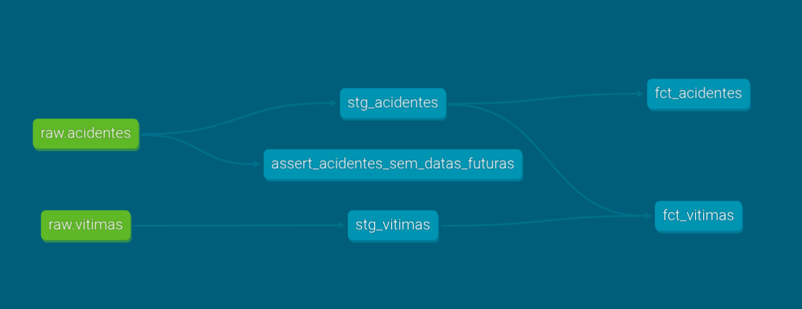

# Traffic Accidents POA 🚦

An end-to-end data pipeline that extracts, transforms and loads public traffic accident data from Porto Alegre (Brazil) into a containerized PostgreSQL database, modeling accidents and victims as two related tables, and serves the results through a BI dashboard.

This project is being built incrementally as a modern data engineering portfolio. The next step is orchestration with Apache Airflow.

---

## 📊 Dashboard

Built with **Metabase**, running as a container alongside PostgreSQL, and reading the analytics tables modeled with dbt.


**Key findings**

- Accidents grew steadily from 2021 to 2025, with a sharp drop in **May 2024**, the month of the floods that paralyzed Porto Alegre
- **Motorcycles** account for **22,693 victims** (about 60% of all victims), 2.3 times more than cars, the second most common vehicle type
- Accidents peak during commuting hours, at **8 AM** and especially **6 PM** (6,840 accidents)
- **63.3%** of accidents caused only property damage, **36.2%** caused injuries and **0.5%** were fatal (447 cases)

---

## 🏗️ Architecture

```
 data/raw/*.csv
      │
      ▼
 ┌──────────┐    ┌────────────┐    ┌─────────────┐
 │ extract  │───▶│ transform  │───▶│    load     │
 │ (pandas) │    │ (pandas)   │    │ (SQLAlchemy)│
 └──────────┘    └─────┬──────┘    └──────┬──────┘
                       │                  │
                 tested with              ▼
                   Pytest      ┌──────────────────────────────┐
                               │  PostgreSQL (Docker Compose) │
                               │                              │
                               │  public    (raw tables)      │
                               │     │                        │
                               │     ▼  dbt build             │
                               │  analytics (staging, marts)  │
                               │     │                        │
                               │     ▼                        │
                               │  Metabase (port 3000)        │
                               └──────────────────────────────┘
```

---

## 🛠️ Tech Stack

- **Python 3.12**
- **Pandas** for extraction and transformation
- **Pytest** for unit tests of the transformation logic
- **PostgreSQL 16** as the database
- **Docker & Docker Compose** to run PostgreSQL and Metabase in isolated, reproducible containers
- **dbt Core** for in-database modeling, data tests and documentation
- **SQLAlchemy + psycopg** for the database connection
- **python-dotenv** for credentials management
- **Metabase** for the BI dashboard

---

## 📁 Data Source

Open data published by EPTC (Porto Alegre's traffic authority) through the city's open data portal:

- [**Acidentes**](https://dadosabertos.poa.br/dataset/acidentes-de-transito-acidentes) (accidents): one row per traffic accident
- [**Vítimas**](https://dadosabertos.poa.br/dataset/acidentes-de-transito-vitimas) (victims): one row per person involved in an accident with injuries or fatalities

---

## 🗂️ Data Model

The victims dataset originally repeated every accident attribute (location, date, vehicles involved). It was **normalized**: the `vitimas` table keeps only victim-specific columns and references its accident through `idacidente`.

```
 acidentes (1) ───────< (N) vitimas
   idacidente               id
   data, hora               idacidente
   log1, log2               idade, fx_et
   latitude, longitude      sexo
   tipo_acid, ups           sit_vitima
   feridos, mortes ...      tipo_veic
   vehicle counts ...       periododia
```
---

## 🧱 dbt Modeling

The raw tables loaded by the Python pipeline are modeled with **dbt** into two layers inside PostgreSQL:

- **Staging** (views): `stg_acidentes` removes the records with invalid future dates; `stg_vitimas` selects victim-specific columns
- **Marts** (tables): `fct_acidentes` adds a readable severity column; `fct_vitimas` joins each victim with its accident's date, time and location

A single rule written once in staging propagates to every downstream table: filtering 4 invalid accidents also removed their victim from `fct_vitimas`, without any extra filter.



---

## 🔄 Transformations

**Accidents**
- Dropped metadata and low-value columns (`data_extracao`, `predial1`, `consorcio`)
- Converted `data` to `datetime` and `hora` to `time` (removing a 7-digit fractional suffix)
- Converted `idacidente` from text (`678074,0`) to integer
- Explicitly typed `hora` as `TIME` in PostgreSQL

**Victims**
- Selected only the 8 victim-specific columns (normalized model)
- Converted `idade` to nullable integer (`Int64`), preserving missing values
- Standardized "unknown" values: the same concept appeared as `NAO INFORMADO`, `NAOINFORMADO`, `NI` and empty values across columns, and all were unified as `NULL`

---

## ✅ Data Quality

**Automated data tests (dbt)**
- 14 tests run on every `dbt build`, covering raw sources and final tables
- Uniqueness and not-null checks on accident and victim IDs
- Accepted values for severity weights (`ups`) and severity labels
- **Referential integrity:** every victim references an existing accident
- A custom test monitors accidents with future dates in the source, as a warning

**Unit tests**
- 8 Pytest tests cover every transformation function, protecting against regressions such as date formats silently turning valid values into nulls

**Issues found in the source data**
- **4 accidents with future dates** (up to 2029), beyond the data extraction date. They are filtered out in the dbt staging layer and monitored by a warning-level test
- An unusually high number of accidents at **midnight**, suggesting unknown times may be recorded as `00:00`

---

## 📂 Project Structure

```
traffic-accidents-poa/
├── data/raw/              # Source CSV files
├── docs/images/           # Dashboard and dbt lineage screenshots
├── src/
│   ├── extract.py         # Reads the CSV files
│   ├── transform.py       # Cleans and normalizes both datasets
│   ├── load.py            # Loads DataFrames into PostgreSQL
│   └── main.py            # Orchestrates the full pipeline
├── tests/
│   └── test_transform.py  # Unit tests for the transformations
├── acidentes_dbt/
│   ├── models/
│   │   ├── staging/       # Source declarations and staging views
│   │   └── marts/         # Final tables and their tests
│   ├── tests/             # Custom data tests
│   └── dbt_project.yml    # dbt project configuration
├── docker-compose.yml     # PostgreSQL and Metabase services
├── .env.example           # Template for database credentials
├── pytest.ini
└── requirements.txt
```

---

## ⚙️ How to Run

**Prerequisites:** Docker, Docker Compose and Python 3.12+

1. **Clone the repository**

```bash
   git clone https://github.com/junioorst/traffic-accidents-poa.git
   cd traffic-accidents-poa
```

2. **Configure the credentials**

```bash
   cp .env.example .env
```

   Fill in `POSTGRES_USER`, `POSTGRES_PASSWORD` and `POSTGRES_DB` in the `.env` file.

3. **Start PostgreSQL and Metabase**

```bash
   docker compose up -d
```

4. **Create the virtual environment and install dependencies**

```bash
   python3 -m venv .venv          # On Windows: python -m venv .venv
   source .venv/bin/activate      # On Windows: .venv\Scripts\activate
   pip install -r requirements.txt
```

5. **Run the pipeline**

```bash
   python src/main.py
```

6. **Build the dbt models**

   The first time, create the dbt connection profile by running `dbt init` inside the `acidentes_dbt` folder, or create it manually at `~/.dbt/profiles.yml` (on Windows: `%USERPROFILE%\.dbt\profiles.yml`) with the same credentials from your `.env` file and `schema: analytics`. Then:

```bash
   cd acidentes_dbt
   dbt build
   cd ..
```

   This requires a dbt profile pointing to the same database (see the [dbt docs on profiles](https://docs.getdbt.com/docs/core/connect-data-platform/connection-profiles)).

7. **Run the tests**

```bash
   pytest
```

8. **Open the dashboard**

   Go to `http://localhost:3000`, create an admin account and add a PostgreSQL database with host **`postgres`** (the Docker Compose service name), port `5432` and the credentials from your `.env` file.

---

## 🔍 Example Query

Victims by vehicle type and accident zone, using the dbt mart (no join needed):

```sql
SELECT regiao, tipo_veic, COUNT(*) AS victims
FROM analytics.fct_vitimas
GROUP BY regiao, tipo_veic
ORDER BY victims DESC;
```

---

## 🗺️ Roadmap

- [x] Extraction, transformation and loading with Pandas
- [x] PostgreSQL with Docker Compose
- [x] Normalized accidents and victims model
- [x] Unit tests for transformations with Pytest
- [x] BI dashboard with Metabase
- [x] dbt models (staging and marts) with data tests
- [ ] Orchestration with Apache Airflow
